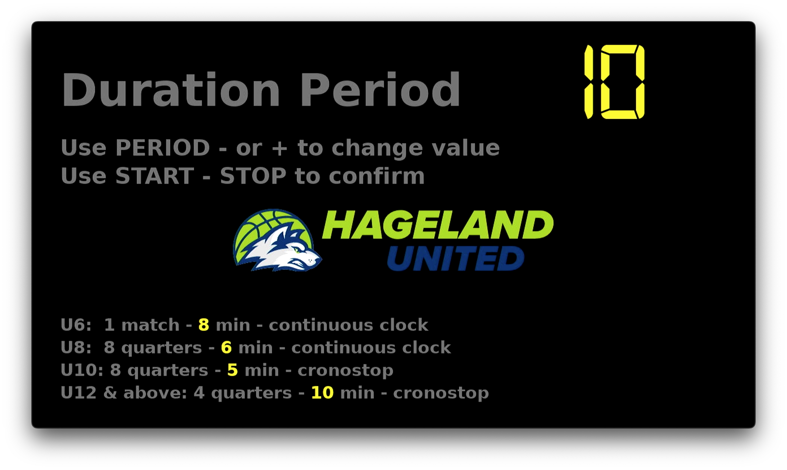
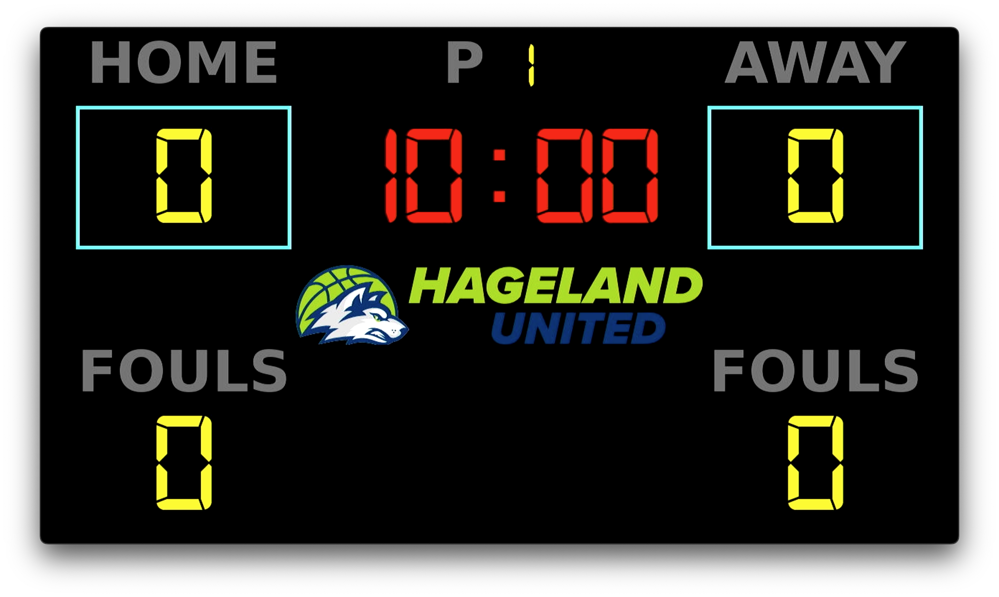
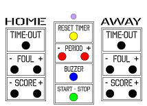

# Basketball clock with HDMI display
A basketball clock is an important investment for a lot of clubs so this project is intended to build a basketball clock using any HDMI enabled device.

The Raspberry Pi device is plugged into the HDMI port of a TV (or any HDMI enabled device). A buzzer is connected to the GPIO pins of the Raspberry Pi.

When booting up the Raspberry Pi, you get a configscreen that allows you to select the default time of a period.  This is required because U6/U8/U10/U12 & all above, have different period durations.


After selecting the period, you get to the actual scoreboard:



The supported features are:
- Main clock with start/stop and button for reset
- Fouls home/guest
- Score home/guest
- TimeOut home/guest
- Period
- Possession arrow (in the code, not mapped to a key or button at the moment)
- Tenths of a second in the last minute
- Time-out rules (2 in the first half, 3 in the second half, max 2 in the last 2 minutes, 1 per overtime)
- The game is kept when the program restarts (e.g. after a crash)
- Connection indicator for the WiFi remote (dot in the bottom right corner)
- Adapts to the resolution of the TV

## What is required?
The basketball scoreboard with clock can be controlled with a wireless keyboard or via a WiFi network.
* Keyboard control only 
  * Raspberry PI
* WiFi control + Keyboard control
  * Raspberry PI
  * Micropython micro controller
  * Box + 15 buttons for the controls



## Howto build this project
### Raspberry
[Installation manual](install/INSTALL.md)
  
### Remote keyboard
The Remote keyboard is based upon a button matrix of 3x5. The wiring (button matrix, wire colours,
ESP32 pins and the status LED) is drawn in [nodemcu/wiring.html](nodemcu/wiring.html): download it
and open it in a browser.

Each button press is sent once (debounced, holding a button does not repeat it). The remote sends a heartbeat
every 2 seconds, so the scoreboard can show whether the remote is connected.

### Keyboard
Key | Command | Key | Command
--- | ------- | --- | -------
Space | Start / stop clock | T | Reset timer
S / X | Score home + / - | J / N | Score away + / -
D / C | Foul home + / - | H / B | Foul away + / -
E | Time-out home | U | Time-out away
Y / R | Period + / - | V | Buzzer
Esc | Quit (restarts when running as a service) | |

### NodeMCU
In the folder *nodemcu*, you can find the code for the NodeMCU microPython device.

## Club settings
Everything specific to a club is in the folder [club](club): the logo, the settings in
[config.ini](club/config.ini) and the manuals for the operators.

## Development
The game rules are in `game.py` and can be tested on any computer, without a Raspberry Pi:
```bash
python3 -m unittest discover tests
```

## License
[MIT](LICENSE)
