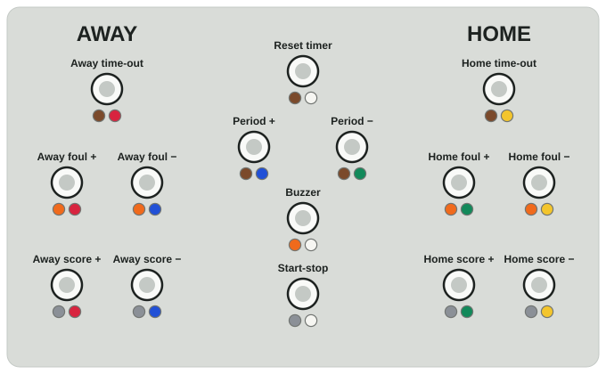
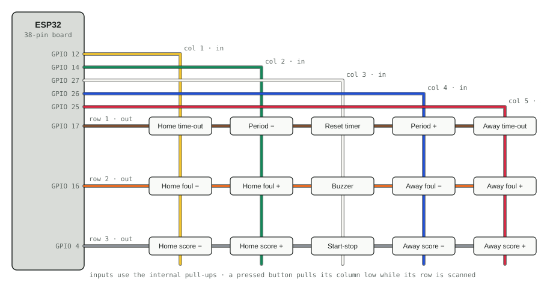
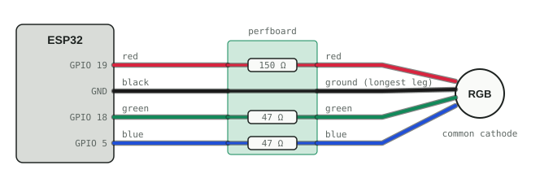

# Basketclock Remote Wiring

The 15 buttons form a key matrix of 3 rows and 5 columns. Each button has two legs: one goes to its row wire,
the other to its column wire. The ESP32 drives one row low at a time and reads which column goes low.

## 1 · Panel, seen from the wiring side

Each button shows its two legs: the left dot is its row wire and the right dot its column wire. Buttons with
the same dot colour are chained with one wire.

## 2 · Key matrix to the ESP32

The same wiring as a schematic. Rows run across, columns run down, and each box is a button between the two.

## 3 · Status LED

An RGB LED with a common cathode, wired through the small green perfboard. Each colour line has its own
resistor on the perfboard (150 Ω for red, 47 Ω for green and blue); ground passes straight through. On the LED,
the leg order is red, ground (longest leg), green, blue (shortest leg).

Resistor per colour: R = (3.3 V − Vf) / I, with the ESP32 pin at 3.3 V and 5–10 mA through the LED (20 mA is
the pin's comfortable maximum). Use the forward voltages from the LED's datasheet if it has one.

Line | Vf (typical) | Calculation | Recommended | Fitted
---- | ------------ | ----------- | ----------- | ------
red · GPIO 19 | ≈ 2.0 V | 1.3 V / 8 mA ≈ 160 Ω | 150–220 Ω | **150 Ω** ≈ 9 mA
green · GPIO 18 | ≈ 3.0–3.2 V | 0.3 V / 5 mA ≈ 60 Ω | 47–100 Ω | **47 Ω** ≈ 2–6 mA
blue · GPIO 5 | ≈ 3.0–3.2 V | 0.3 V / 5 mA ≈ 60 Ω | 47–100 Ω | **47 Ω** ≈ 2–6 mA

Green and blue have only 0.1–0.3 V left over at 3.3 V, so a larger resistor such as 220 Ω makes them very dim
(about 1 mA). Balance the colours with the resistor values, not in the code: a lower value gives a brighter
colour. The firmware already caps the brightness at about 20% PWM.

## ESP32 pin list

Wire | GPIO | Line | Buttons on it
---- | ---- | ---- | -------------
brown | 17 | Row 1 (output) | Home time-out, Period −, Reset timer, Period +, Away time-out
orange | 16 | Row 2 (output) | Home foul −, Home foul +, Buzzer, Away foul −, Away foul +
gray | 4 | Row 3 (output) | Home score −, Home score +, Start-stop, Away score −, Away score +
yellow | 12 | Column 1 (input) | Home time-out, Home foul −, Home score −
green | 14 | Column 2 (input) | Period −, Home foul +, Home score +
white | 27 | Column 3 (input) | Reset timer, Buzzer, Start-stop
blue | 26 | Column 4 (input) | Period +, Away foul −, Away score −
red | 25 | Column 5 (input) | Away time-out, Away foul +, Away score +
red | 19 | LED red, through 150 Ω | status LED
green | 18 | LED green, through 47 Ω | status LED
blue | 5 | LED blue, through 47 Ω | status LED
black | GND | LED common cathode | status LED
